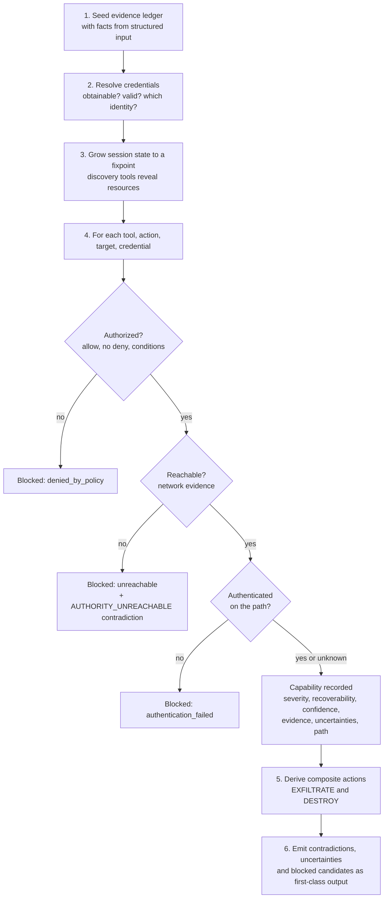
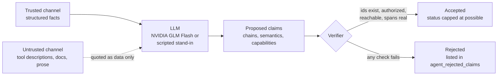
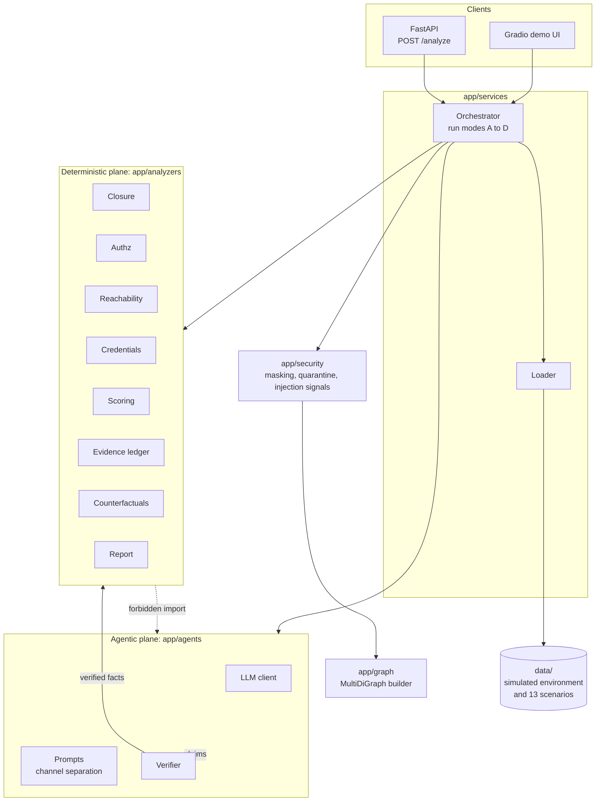

<div align="center">

# 🛡️ Agent Blast-Radius Analyzer

### What can an AI agent *actually* affect, how did it get that capability, and what would reduce it?

Deterministic analysis of AI-agent environments, with an LLM layer whose every claim is **verified before it is reported**.

<br/>


[Overview](#-overview) ·
[Results](#-headline-result) ·
[How it works](#-how-it-works) ·
[Quickstart](#-quickstart) ·
[Architecture](#-architecture) ·
[Roadmap](#-roadmap-and-future-improvements)

</div>

---

## 📌 Overview

Permission scanners answer *"what is this agent allowed to do?"*. That is not the question that matters. An agent with **no production grants** can still reach production:

```text
read_file("./.env")      -> deploy token            (credential discovery)
read_env("CI_*")         -> CI endpoint             (resource discovery)
http_request(CI, token)  -> pipeline                (network + authentication)
http_request(pipeline, action=deploy)               (authorization + action semantics)
                         => PRODUCTION DEPLOYMENT with zero production IAM grants
```

Each tool is harmless on its own. Together they form a deployment pipeline. **Blast radius is a property of composition, state, and semantics, not of the permission list.**

This project ingests an agent's environment (identity, tools, credentials, permissions, network, resources, and security controls) and computes its **effective blast radius**: the real-world state changes the agent could cause if it were confused, manipulated, or compromised.

### ✨ Key features

| | Feature | Why it matters |
| --- | --- | --- |
| 🧮 | **Deterministic capability closure** | Reproducible, explainable results from graph traversal, IAM evaluation, and reachability |
| 🤖 | **Verifier-gated LLM reasoning** | The model proposes attack chains; a deterministic verifier accepts or rejects each one |
| 🧾 | **Evidence ledger** | Every HIGH/CRITICAL finding needs at least 2 FACT evidence items or it is downgraded |
| ❓ | **Unknown is not safe** | Missing input yields an explicit uncertainty, never a clean bill of health |
| 🔀 | **Declared vs effective authority** | Contradictions such as "allowed by policy but unreachable" are reported, not hidden |
| 🔬 | **Counterfactuals** | Shows which control provably shrinks the blast radius (analysis only, nothing applied) |
| 🔒 | **Prompt-injection resistant by design** | Untrusted text travels in a separate channel and is treated as data, never instructions |
| 📊 | **Measured ablation** | A/B/C/D run modes prove whether the LLM layer actually helps |

### 🎯 What this project demonstrates

- **Systems design:** a strict deterministic/agentic split, enforced by an architecture test rather than a convention.
- **Trustworthy AI engineering:** LLM output is treated as untrusted input to a verifier, and rejected claims are shown to the user.
- **Security thinking:** IAM semantics, credential obtainability, network reachability, blast-radius and recoverability modelling.
- **Evaluation discipline:** a baseline built first, a measured ablation, negative expectations, and an explicit "kill test" for the LLM layer.
- **Production practice:** typed Pydantic v2 schemas, FastAPI, Docker, GitHub Actions CI, 56 tests, and lint-clean code.

---

## 📈 Headline result

Capability recall over a 13-scenario corpus, comparing the deterministic baseline against the agentic system:

| Run mode | Adds | Recall | Precision | F1 | False-positive rate |
| --- | --- | :---: | :---: | :---: | :---: |
| `A_deterministic` | facts only (IAM, credentials, reachability, action semantics) | 0.944 | 1.000 | 0.971 | 0.000 |
| `B_interpret` | + LLM tool-semantics interpretation | **1.000** | 1.000 | 1.000 | 0.000 |
| `C_agentic` | + tool composition across tools | **1.000** | 1.000 | 1.000 | 0.000 |
| `D_full` | + state-dependent analysis and counterfactuals | **1.000** | 1.000 | 1.000 | 0.000 |

The one capability the baseline **cannot** find is the composed chain shown in the overview. No structured `DISCOVERS` edge points at production, so only the agentic layer proposes it. The verifier accepts it **only** because obtainability, reachability, and authorization all check out, and it is reported as `possible`, never `confirmed`. No scenario gained a false positive to get there.

> [!NOTE]
> The corpus is small and hand-authored. Treat these numbers as a sanity check, not proof of general accuracy. See [Limitations](#-limitations-and-honest-caveats).

---

## 🔍 How it works

### End-to-end pipeline

```mermaid
flowchart LR
    A["Environment input<br/>identity, tools, credentials,<br/>policies, network, resources, controls"] --> B["Loader and<br/>schema validation"]
    B --> C["Security layer<br/>masking, trust quarantine,<br/>injection signals"]
    C --> D["Environment graph<br/>heterogeneous MultiDiGraph"]
    D --> E["Deterministic engine<br/>capability closure"]
    E --> F{"Run mode<br/>A, B, C or D?"}
    F -- "A" --> H["Scoring and evidence"]
    F -- "B, C, D" --> G["Agentic layer<br/>LLM proposes"]
    G --> V["Deterministic verifier<br/>accepts or rejects"]
    V --> H
    H --> I["Counterfactuals<br/>which control shrinks the radius?"]
    I --> J["Report<br/>findings, uncertainties,<br/>rejected claims"]
```



### Deterministic capability closure



Blocked candidates are kept rather than dropped, so a report can show *declared but not effective* authority.

### Agentic layer: the LLM proposes, the verifier disposes



<details>
<summary><b>The five analysis layers (L0 to L4)</b></summary>

<br/>

| Layer | Meaning | Source |
| --- | --- | --- |
| **L0 Declared authority** | what the configuration *claims* | parsed policies, prose metadata |
| **L1 Reachable authority** | what the agent can physically reach and authenticate to | credentials, network, endpoints |
| **L2 Effective capability** | what it can actually *do*, including multi-tool and multi-step paths | computed |
| **L3 Potential impact** | what happens if it does, including recoverability and dependents | computed from facts |
| **L4 Effective blast radius** | L2 ∩ L3, filtered by blockers, verified, evidence-backed | **the product** |

Every report shows L0 and L1 separately with the delta between them, because that gap is where both false alarms and real danger hide.

</details>

<details>
<summary><b>Verification status, confidence, and composite actions</b></summary>

<br/>

- **Status:** each capability is `confirmed`, `probable`, `possible`, `unverified`, or `contradicted`. A capability that needs session state, an unverified condition, or unknown authentication is downgraded from `confirmed` to `probable`.
- **Confidence** is computed from evidence, never self-asserted. It combines a status weight with the number of independent FACT evidence items, and is capped by the status ceiling.
- **`EXFILTRATE`** is derived from a sensitive read, plus a reachable route out of the boundary, plus no egress-inspection (DLP) control covering that environment.
- **`DESTROY`** is derived from a delete on a resource whose recovery mechanisms are absent, or are themselves deletable by this agent.
- **Every path is falsifiable:** each hop in a reported capability path must correspond to a real edge in the environment graph.

</details>

### 🧭 Design principles

1. **Deterministic where possible, agentic only where semantics are genuinely required.**
2. **Evidence or it didn't happen.** HIGH and CRITICAL findings need at least 2 FACT items.
3. **Unknown is not safe.** `None` means UNKNOWN everywhere.
4. **Read-only and analysis-only.** It never mutates the environment, executes input-derived commands, or handles secret values (only locators).
5. **Untrusted text is data, never instructions.** Injection is handled structurally, by channel separation.
6. **Baseline first.** If the LLM does not measurably improve the result, it is removed (the "kill test").

---

## 🏗️ Architecture



> [!IMPORTANT]
> **Enforced boundary:** the deterministic plane never imports the agentic plane. `tests/unit/test_architecture.py` fails the build if it does, so the "LLM-free core" claim is checked, not promised.

The UI and the API both end at `app.services.orchestrator.analyse`, so the demo and the API cannot drift apart. The UI always shows the baseline next to the agentic result, including rejected claims and unmet uncertainties, because hiding them would make the product look more confident than it is.

---

## 🖥️ Demo UI

| Tab | Shows |
| --- | --- |
| **Capabilities** | action, target, environment, severity, status, confidence, state depth, discovered-by, path |
| **Findings** | severity, finding, recoverability, confidence, supporting facts, open uncertainties |
| **Counterfactuals** | controls that provably shrink the blast radius |
| **Report** | the full text report |
| **Graph** | the capability chain as JSON |
| **Honesty** | rejected claims, unmet uncertainties, and the agentic trajectory |

<!-- Add screenshots here:
<p align="center">
  
</p>
-->

---

## 🚀 Quickstart

<details open>
<summary><b>🪟 Windows (PowerShell)</b></summary>

```powershell
powershell -ExecutionPolicy Bypass -File .\scripts\setup_env.ps1   # creates or updates .\Agent3
.\Agent3\Scripts\Activate.ps1
python -m pytest
python -m ruff check app gradio_app tests scripts
python scripts\run_eval.py --mode D_full          # score the whole corpus
python scripts\run_eval.py --ablation             # the A/B/C/D table
python scripts\run_eval.py --scenario scenario-06 --print-report
```

</details>

<details>
<summary><b>🐧 Linux / macOS</b></summary>

```bash
git clone https://github.com/AK-Jeevan/Agent_Blast_Radius_Analyzer.git
cd Agent_Blast_Radius_Analyzer
python3 -m venv .venv && source .venv/bin/activate
pip install -r requirements.txt
cp .env.example .env
python -m pytest
python scripts/run_eval.py --ablation
```

</details>

<details>
<summary><b>🐳 Docker</b></summary>

```bash
cp .env.example .env
docker compose up --build
```

See `Dockerfile` and `docker-compose.yml` for services and ports.

</details>

### Run the servers

```bash
uvicorn app.main:app --reload --port 8000     # API, interactive docs at /docs
python gradio_app/app.py                      # demo UI (port 7860)
```

### Call the API

```bash
curl -X POST http://127.0.0.1:8000/analyze \
  -H "content-type: application/json" \
  -d '{"scenario_id":"scenario-06","run_mode":"D_full","with_counterfactuals":true,"prefer_real_llm":false}'
```

| Field | Meaning |
| --- | --- |
| `scenario_id` | scenario from `data/scenarios/` |
| `run_mode` | `A_deterministic`, `B_interpret`, `C_agentic`, or `D_full` |
| `with_counterfactuals` | also compute which controls would shrink the radius |
| `prefer_real_llm` | use the NVIDIA model instead of the scripted stand-in |

### Use the real LLM

By default the agentic layer uses a **deterministic scripted stand-in**: reproducible, offline, and free.

```bash
export NVIDIA_API_KEY="nvapi-..."
export NVIDIA_MODEL="z-ai/glm-5.3-flash"
export LLM_PREFER_REAL="true"
python scripts/run_eval.py --mode D_full --real-llm
```

Whatever the model proposes faces the same verifier. Unknown entity ids, missing authorization, unreachable targets, and invented spans are **rejected and printed** in `agent_rejected_claims`. If the endpoint is unreachable, runs fall back to the stand-in and report `MODEL_UNAVAILABLE_FALLBACK`.

> [!WARNING]
> Keep `NVIDIA_API_KEY` in `.env` or the process environment. `.env` is git-ignored. Never commit it.

---

## ☁️ Deploying to AWS EC2

> Phase 16 (AWS deployment) is in progress. This is a minimal, security-conscious path.

1. Launch an Ubuntu instance with this security group:
   - **22 (SSH):** source **My IP** only
   - **7860 (Gradio):** public only if you intend to share the demo, otherwise My IP
   - **8000 (API):** do not expose. The UI calls the service layer directly.
2. Install and run:
   ```bash
   sudo apt update && sudo apt install -y python3-venv git
   git clone https://github.com/AK-Jeevan/Agent_Blast_Radius_Analyzer.git
   cd Agent_Blast_Radius_Analyzer
   python3 -m venv .venv && source .venv/bin/activate
   pip install -r requirements.txt
   cp .env.example .env      # add NVIDIA_API_KEY, set the Gradio host to 0.0.0.0
   python gradio_app/app.py
   ```
3. Or open no app port at all and use an SSH tunnel, then browse to `http://localhost:7860`:
   ```bash
   ssh -i key.pem -L 7860:localhost:7860 ubuntu@<public-ip>
   ```

> [!CAUTION]
> The demo has **no authentication**. With the real-LLM option enabled, anyone who can reach it can spend your API quota. Use a tunnel, an IP allow-list, or an auth proxy before sharing it.

---

## ✅ Testing and quality

| Check | Command |
| --- | --- |
| 56 unit, integration, and security tests | `python -m pytest` |
| Lint | `python -m ruff check app gradio_app tests scripts` |
| Score the corpus | `python scripts/run_eval.py --mode D_full` |
| A/B/C/D ablation | `python scripts/run_eval.py --ablation` |
| Regenerate the evaluation report | `python scripts/build_eval_report.py` |

- **13 scenarios**, each with machine-checked *positive* and *negative* expectations (what must be found, and what must not be).
- **Architecture test** keeps the deterministic plane free of LLM imports.
- **Security tests** cover masking, trust quarantine, and prompt-injection signals, including two adversarial tools in the corpus.
- **CI:** GitHub Actions for tests, security scanning, and Docker builds.

---

## 📁 Repository layout

<details>
<summary><b>Show project tree</b></summary>

```text
app/
  analyzers/    DETERMINISTIC plane: graph, authz, reachability, credentials, closure,
                scoring, evidence, blast_radius, report, counterfactual
  agents/       AGENTIC plane: client (NVIDIA GLM Flash + scripted stand-in), prompts
                (channel separation), verifier, pipeline
  graph/        heterogeneous MultiDiGraph builder, typed views, bounded paths
  security/     masking, trust quarantine, injection signals
  evaluation/   scenario runner, metrics, ablation harness
  api/          FastAPI routes and request/response schemas
  services/     data loader, orchestrator (run modes), run store
  schemas/      Pydantic v2 models matching docs/DATA_MODEL.md
  main.py       app factory
data/           simulated environment: 4 environments, 17 resources, 16 tools (2 adversarial),
                7 credentials, 13 policies, 25 network edges, 6 controls, 6 agents
  scenarios/    13 scenarios with machine-checked expectations
gradio_app/     demo UI
tests/          unit, integration, security
scripts/        setup_env.ps1, run_eval.py, build_eval_report.py
docs/           design documents and generated EVALUATION_REPORT.md
.github/        tests.yml, security.yml, docker.yml
```

</details>

### 📚 Documentation

| Document | Contents |
| --- | --- |
| [`PHASE_0_PROBLEM_DEFINITION`](docs/PHASE_0_PROBLEM_DEFINITION.md) | problem statement, five-layer model, action taxonomy, decision log |
| [`DATA_MODEL`](docs/DATA_MODEL.md) | every entity, field, relationship, and output object |
| [`ANALYSIS_ENGINE_SPEC`](docs/ANALYSIS_ENGINE_SPEC.md) | closure algorithm, severity and recovery formulas, evidence and confidence model |
| [`SIMULATED_ENVIRONMENT`](docs/SIMULATED_ENVIRONMENT.md) | the offline fictional dataset and its ground-truth invariants |
| [`EVALUATION_PLAN`](docs/EVALUATION_PLAN.md) | scenarios, ablation, metrics, adversarial suite, kill test |
| [`MVP_ARCHITECTURE`](docs/MVP_ARCHITECTURE.md) | module map, run modes, build order, constraints |
| [`EVALUATION_REPORT`](docs/EVALUATION_REPORT.md) | generated evaluation results |

---

## ⚠️ Limitations and honest caveats

- **Small, synthetic corpus.** The 13 scenarios were written by the author, so perfect scores on them are a sanity check, not evidence of general accuracy. The planned 50+ unseen-scenario kill test has **not** been run.
- **Real-model results are pending.** The NVIDIA endpoint was unreachable from the development machine, so the reported numbers come from the scripted stand-in.
- **Simulated environment only.** It does not yet ingest live cloud accounts, real IAM exports, or real MCP tool manifests.
- **Static discovery.** Which resources a tool can reveal is a fixed property of the tool, so session state depth is effectively 0 or 1.
- **No authentication on the demo UI.**

---

## 🗺️ Roadmap and future improvements

| Phase | Scope | Status |
| --- | --- | --- |
| 0 | Problem definition, data model, engine spec, environment, evaluation plan | ✅ Complete |
| 1-5 | Corpus, schemas, masking, graph, deterministic analyzer, scoring, evidence | ✅ Complete |
| 6-10 | NVIDIA client, verifier-gated proposals, composition, stateful analysis, counterfactuals | ✅ Complete |
| 11-13 | Evaluation harness and ablation, FastAPI, Gradio | ✅ Complete |
| 14-15 | Docker and compose, GitHub Actions | ✅ Complete |
| 16-17 | AWS deployment, richer observability (tracing, Prometheus) | 🚧 In progress |
| 18 | Kill test on 50+ unseen scenarios, live-model evaluation, final packaging | ⏳ Not started |

**Ideas beyond the current roadmap**

- [ ] **Real inputs:** import AWS IAM policy JSON, Kubernetes RBAC, and MCP tool manifests
- [ ] **Held-out benchmark:** a larger, independently authored scenario set to test generalization
- [ ] **Multiple LLM backends:** compare models on the same verifier-gated pipeline
- [ ] **Dynamic discovery:** discovery that depends on credentials and state gained during a session
- [ ] **Remediation output:** counterfactuals as reviewable policy diffs (never auto-applied)
- [ ] **Visual attack graphs:** interactive rendering of capability paths in the UI
- [ ] **Auth and multi-user support:** login, per-user history, and rate limiting for the hosted demo
- [ ] **CI gating:** fail a pull request when a change increases an agent's blast radius

---

## 🧰 Tech stack

**Language and data:** Python · Pydantic v2 · NetworkX
**Services:** FastAPI · Uvicorn · Gradio
**AI:** NVIDIA API (GLM Flash) with a deterministic scripted stand-in
**Quality and delivery:** pytest · Ruff · Docker · GitHub Actions
**Cloud:** AWS EC2

---

## 🤝 Contributing

Issues and pull requests are welcome. Before opening a PR, please run:

```bash
python -m pytest
python -m ruff check app gradio_app tests scripts
```

New scenarios are especially valuable: add one to `data/scenarios/` with both positive and negative expectations.

## 📄 License

Released under the **MIT License**. The simulated environment contains no real credentials, endpoints, or customer data.

## 👤 Author

**AK Jeevan** · [GitHub @AK-Jeevan](https://github.com/AK-Jeevan)

<div align="center">

⭐ If this project is useful to you, consider giving it a star.

</div>
